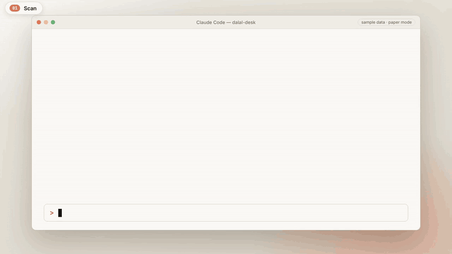
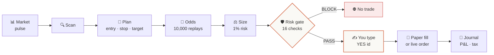

<div align="center">

# 🐂 Dalal Desk

**Your Indian stock market trading desk, inside Claude.**

Scan NSE stocks → plan the trade → check the odds → size it → risk-check it → approve it → review it.

[](#-quick-start)
[](#-what-it-does)
[](#%EF%B8%8F-safety-rails)
[](#-quick-start)
[](#-quick-start)
[](https://github.com/Abhishek-dev18/dalal-desk/actions/workflows/tests.yml)
[](LICENSE)



<sub>Real output on synthetic sample data; the chat is scripted. The odds said skip, the demo traded anyway on paper,<br>
and it was stopped out with the loss inside the limit. <a href="docs/demo.mp4">Full-quality video</a> · <a href="tools/film/README.md">How it was made</a></sub>

</div>

> [!WARNING]
> **Not investment advice, and no edge built in.** Dalal Desk makes the odds, the costs and the rules visible.
> Most retail day traders lose money. Only use money you can afford to lose.

## 💬 Just talk to Claude

Install it, then ask in plain words. Claude picks the right skill and runs it.

| You say | What happens |
|---|---|
| *"How does the market look today?"* | Breadth score, FII/DII flows, headlines → **Risk-On / Cautious / Risk-Off** |
| *"Find me an intraday setup"* | Ranks stocks by range breaks, VWAP, volume and gaps |
| *"Plan SBIN and tell me the odds"* | Exact entry, stop and target, then **10,000 replays** of the rest of the day |
| *"Give me the trade card"* | One fixed table: share, when to buy, buy at, stop-loss, target, exit by, max loss and profit, odds, verdict |
| *"How many shares can I buy?"* | Size so the loss at the stop, **charges included**, stays under 1% of capital |
| *"Place it"* | A ticket you approve by typing `YES <id>`. Paper fill by default |
| *"How did today go?"* | Settles trades, shows net P&L, charges paid and loss budget left |
| *"Can I afford a Nifty 25300 call?"* | Lot cost, breakeven, implied volatility and daily time decay |

Or use the shortcuts: **`/brief`** · **`/scan`** · **`/trade SYMBOL`** · **`/eod`** · **`/kill`**

## 🔁 What it does



<details>
<summary><b>All 17 skills and their commands</b></summary>

| Step | Skill | Command |
|---|---|---|
| How is the market? | `market-pulse`, `news-catalyst` | `breadth`, `flows`, `news` |
| What is setting up? | `intraday-scanner`, `swing-scanner` | `scan intraday`, `scan swing` |
| Exact entry, stop, target | `trade-plan` | `plan orb`, `plan breakout`, `plan manual`, `entry` |
| What are the odds? | `time-machine` | `sim` (10,000 replays), `backtest` |
| How many shares? | `position-sizer`, `trading-costs` | `size`, `costs` |
| Is it allowed? | `risk-gate` | `gate`, `budget`, `kill on` |
| Place it | `order-ticket` | `ticket new`, `approve`, `execute` |
| When to get out | `exit-watcher` | `watch` (stop, target, trailing stop, exit time, VWAP) |
| Track it | `trade-journal`, `tax-report` | `paper settle`, `journal add`, `journal stats`, `tax` |
| Options | `option-chain`, `option-buyer` | `options pick`, `options chain`, `buycheck`, `greeks`, `iv`, `expiry` |
| Setup and the whole day | `data-doctor`, `daily-routine` | `doctor` |

Sub-agents: `market-analyst`, `setup-analyst`, and `risk-officer` (holds a veto).

</details>

## 🚀 Quick start

Needs Python 3.9+. Nothing to `pip install`.

**1. Install the plugin** in Claude Code:

```
/plugin marketplace add Abhishek-dev18/dalal-desk
/plugin install dalal-desk@dalal-desk
```

**2. Set up a folder** for your trading state:

```
cp /path/to/dalal-desk/config.example.json config.json
cp /path/to/dalal-desk/.env.example .env
python3 /path/to/dalal-desk/dd.py doctor --live
```

**3. Ask Claude:** *"run the morning brief"*

> [!TIP]
> It starts in **paper mode with ₹20,000**. Change `capital` in `config.json` to match yours.
> Prefer not to use the plugin? Clone the repo and copy `skills/` into `~/.claude/skills/`.

<details>
<summary><b>🖥️ Using it from Claude Desktop (when Claude can't reach market sites)</b></summary>

Claude Desktop runs commands in a sandbox that may not reach Yahoo or NSE. The runner bridges that gap:
it runs `dd.py` with Python on your own computer and internet.

1. Make a trading folder, put the `dalal-desk` folder inside it, and copy `config.example.json` to `config.json` there.
2. Copy `dalal-desk/tools/start-runner.bat` into the trading folder and double-click it (Windows).
   On Mac or Linux: `python3 dalal-desk/tools/runner.py --work .`
3. Connect the trading folder to your chat. Claude drops command files into `queue/` and reads the results.

The runner only runs `dd.py` subcommands, never a shell, and all of Dalal Desk's safety rules still apply.

</details>

## 🛡️ Safety rails

Every limit is enforced in code, not just in instructions.

| | Rule |
|---|---|
| 📄 | **Paper mode** until you switch it off |
| 🎯 | **1% risk per trade**, charges included · **2% daily loss stop** · **20% total loss budget** |
| 🔢 | Max **3 trades a day**, **2 open positions**, no leverage unless you raise `mis_leverage` |
| ⏰ | No new intraday entries after **15:00**, flat by **15:10** |
| ⚖️ | Reward must be at least **1.5× risk after charges** |
| 📉 | **Option buying only**, premium capped at 10% of capital. Option selling and delivery shorts are blocked. Set `"option_risk_limit": "warn"` to size one lot and show the risk as warnings instead of blocking (daily stop, total budget and kill switch still block) |
| ✍️ | Orders need a ticket **you approve by typing `YES <id>`**. Tickets expire in 15 minutes and are refused if changed |
| 🪝 | A hook **blocks any broker order tool** that has no matching approved ticket |
| 🛑 | `dd.py kill on` stops everything. **Only you** can clear it, by deleting `trader/KILL` |

> [!IMPORTANT]
> Approval is a process control: Claude is told to pass only what you typed. Keep Claude Code's
> permission prompt for broker tools on **"ask"**, never "always allow".

## 🔌 Data and brokers

| | Option | Notes |
|---|---|---|
| **Data** | `yahoo` *(default)* | Free, no key, ~15 min late. Fine for swing trades, not live intraday entries |
| | `upstox` | Real time. Needs `UPSTOX_ACCESS_TOKEN`, renewed daily |
| | `csv` | Your own `data/SYMBOL_5m.csv` and `SYMBOL_1d.csv` (columns `t,o,h,l,c,v`) |
| **Mode** | `paper` *(default)* · `research` · `live` | `research` blocks every ticket |
| **Broker** *(live only)* | `manual` | Prints the exact orders; you place them in your broker app |
| | `upstox` · `kite` | Sends entry and stop orders by API |

Set these in `config.json`. Secrets go in `.env` only.

<details>
<summary><b>⚠️ Before going live with real money</b></summary>

1. Settle at least **20 paper trades** and read `journal stats`.
2. Start with `mode: live` and `broker: manual`.
3. API orders (`upstox`, `kite`) need the access token in `.env`, `LIVE_TRADING=1`, **and a static IP
   registered with your broker**. SEBI has required this for all API orders since 1 April 2026, and
   most home internet connections don't have one.
4. The Upstox and Kite order adapters were written from the brokers' public docs and **have not been
   run against a live account**. Make your first API order one share.

</details>

<details>
<summary><b>⌨️ The same trade, command by command</b></summary>

```
dd.py scan intraday                      # ranked candidates after 09:30
dd.py plan orb SBIN --side BUY --r 2     # entry, stop, target on the tick grid
dd.py sim                                # 10,000 replays of the rest of the day, net of charges
dd.py size                               # shares so that loss at stop + charges <= 1% of capital
dd.py gate                               # PASS or BLOCK
dd.py card                               # the whole trade as one table
dd.py entry                              # waiting / triggered / expired (closed 5m bars)
dd.py ticket new                         # proposes the order and shows the approval phrase
dd.py ticket approve <id> --typed "YES <id>"
dd.py ticket execute <id>                # paper fill, logged to the journal
dd.py watch                              # open trades: EXIT NOW / BOOK PROFIT / MOVE STOP / WEAK / HOLD
dd.py journal add BHARTIARTL --qty 9 --entry 2159.1 --stop 2139.3 --target 2188.8   # a trade placed by hand
dd.py options pick --file chain.csv --spot 25230 --kind CE   # rank strikes you can afford
dd.py paper settle                       # after the close: stop, target or flat-by
dd.py journal stats
```

</details>

## 🧪 What is tested

- ✅ **32 offline tests**, run on every push by GitHub Actions (`python3 -m unittest discover -s tests -v`): charges, tick rounding, holidays, expiry
  dates, option maths, scanners, sizing, every risk-gate rule, the ticket flow, the order hook and the
  paper broker.
- ❌ **Not yet tested:** live Yahoo and Upstox data, the news feed URLs, and the Upstox and Kite order
  adapters. Run `dd.py doctor --live` on your machine first.

<details>
<summary><b>📅 Rules you must keep current</b></summary>

Indian market rules change often. They live in `dalal/refdata.py` with their effective dates.
Sources are in [`docs/RULES.md`](docs/RULES.md).

- **Charges** (STT, exchange, stamp duty, GST): table effective 1 April 2026. Check against a contract note.
- **Holidays:** the full 2026 NSE list is filled in. Add 2027 once NSE publishes it (`dd.py doctor` warns from November).
- **Lot sizes and expiries:** Nifty 65, weekly expiry Tuesday; Sensex weekly Thursday; others monthly only.
- **Tick sizes** follow NSE price bands; your broker's instrument file is the authority.

</details>

<details>
<summary><b>📁 Repo layout</b></summary>

```
dd.py                 entry point for every command
dalal/                the library (standard library only)
  providers/          yahoo, csv, upstox, kite, paper, manual
skills/               17 skills (one SKILL.md each)
agents/ commands/     sub-agents and slash commands
hooks/                order guard (blocks unapproved broker orders)
universe/             watchlists to scan
tests/                offline tests and fixtures
tools/film/           source of the README film
```

</details>

## 🙏 Credits

Dalal Desk is new code, but its design draws on ideas from other open-source projects, listed in
[`THIRD_PARTY_NOTICES.md`](THIRD_PARTY_NOTICES.md). Licence: [MIT](LICENSE).
